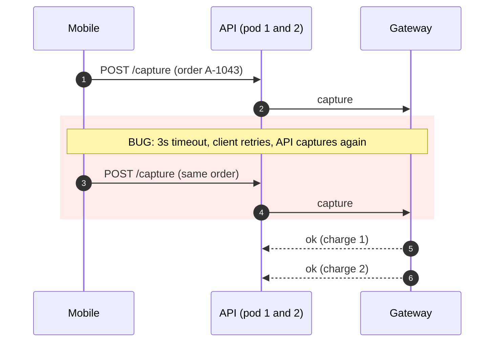
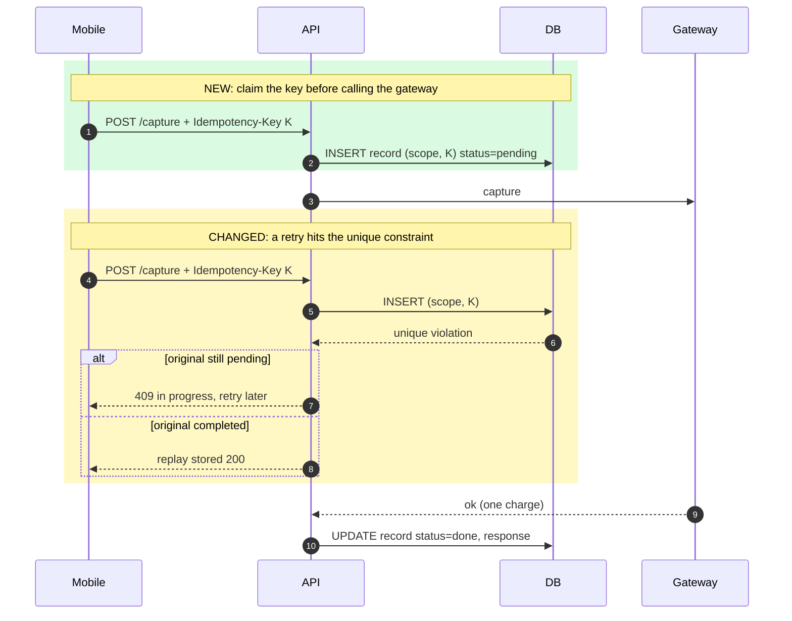
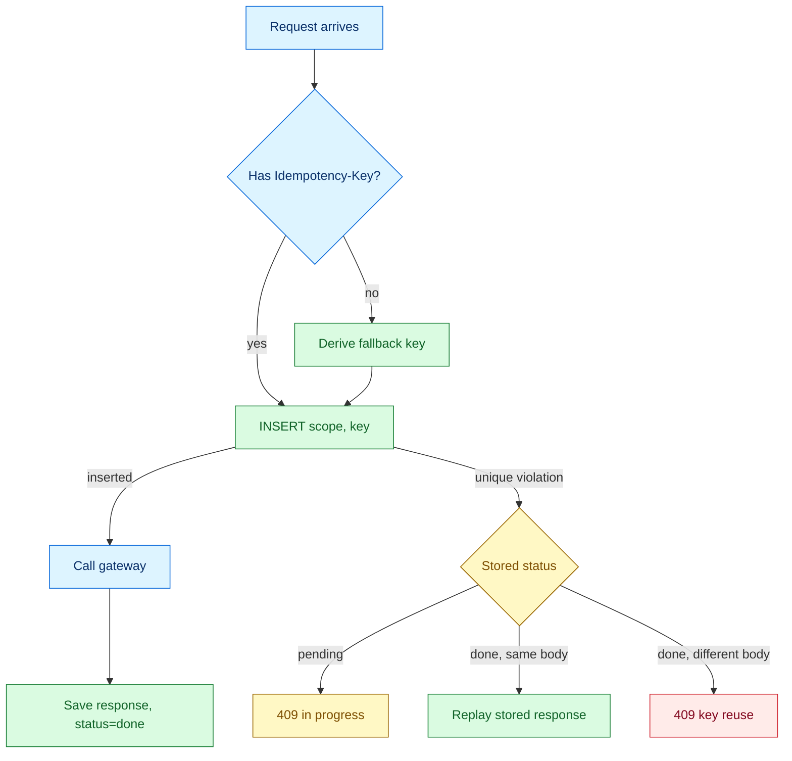

# Make payment capture idempotent so client retries cannot double charge

| Field | Value |
|---|---|
| Work item | #412 |
| Pull request | (link to the PR) |
| Author | |
| Date | 2026-10-15 |
| Type | fix |
| Risk | 🟡 Medium: touches the money path, guarded by a feature flag |

> Fictional example. Shows the source format; all metrics and test passes are illustrative, not executed evidence.
>
> **Unresolved design caveats:** the local unique row does not cover a crash after the gateway charges but before the response is saved; pending-claim recovery and downstream idempotency/reconciliation need design and tests. The orderId + amount fallback can conflate legitimate equal-amount partial captures. Disabling the flag restores the original duplicate-charge risk, and dropping the table loses deduplication state. The After diagram's completed-replay branch must occur after persistence; treat it as an ordering defect to correct against a real implementation. Red on the expected 409 rejection conflicts with the palette. Do not copy these limitations as verified behavior.

---

## 🟦 1. Why (Context Log)

- 🔵 2026-10-14 09:12 support ticket: customer charged twice for order `A-1043`
- 🔵 Logs show two `POST /payments/capture` calls 1.8s apart, same `orderId`, different pods
- 📝 Mobile client retries once after a 3s timeout
- 📝 Capture latency: p95 2.6s, p99 4.1s (gateway is slow at peak)
- 📝 `payments` has no uniqueness on the request, only on `id`

**Problem statement:** When capture takes longer than the client's 3s timeout, the mobile app retries, and the API captures again because nothing makes the capture request idempotent.
**Impact:** about 0.4% of captures at peak hours since the 2026-09-30 gateway change. Refunds handled manually.

---

## 🟪 2. Thinking

**Method:** Hypothesis → Experiment, then Trade-off Matrix

### 2a. Investigation trail

| # | Hypothesis | Experiment / Evidence | Result |
|---|---|---|---|
| H1 | Gateway sends a duplicate webhook | Gateway dashboard: one webhook per charge | ❌ rejected |
| H2 | Client retries on timeout | Staging replay with gateway throttled to 3.5s | ✅ confirmed |
| H3 | Two pods process concurrently and neither sees the other | Parallel `curl` to two pods, both succeed | ✅ confirmed (contributing) |

- 💡 **Insight:** Retrying is correct client behaviour. The server must be idempotent, so the fix belongs in the API, not in the app.

### 2b. Options considered

| Option | Pros | Cons | Verdict |
|---|---|---|---|
| A. `Idempotency-Key` header + unique `(scope, key)` row, replay stored response | Durable, industry standard, works across pods | New table, clients must send the key | ✅ chosen |
| B. Raise client timeout to 10s | One-line change | Hides the problem; any network retry still duplicates | ❌ dropped |
| C. Redis lock per `orderId` | Fast | New infra dependency, TTL expiry edge cases, not durable | ❌ dropped |
| D. Unique constraint on `order_id` | Simple | Blocks legitimate partial captures | ❌ dropped |

**Decision:** We chose **A** because a database unique constraint is the only guard that is atomic across pods and survives restarts. We accept a new table and a client change.

**Assumptions:**
- 📝 Keys are unique per user intent (client generates a UUID per tap, not per retry)
- 📝 Until #88 ships, the server derives a fallback key from `orderId + amount`

---

## 🟩 3. What changed

- ✅ `IdempotencyInterceptor` (NestJS) reads `Idempotency-Key`
- ✅ Migration: `idempotency_records` with unique `(scope, key)`
- ✅ Replay returns the stored 2xx response; same key with a different body returns `409`
- ✅ Flag `PAYMENT_IDEMPOTENCY_ENABLED` (default off)
- ➡️ Mobile app sends the key: #88
- ❓ Key retention: 24h or 7d?

**Files that matter:**
- `src/payment/idempotency.interceptor.ts`: the claim/replay logic
- `migrations/20261015_idempotency_records.ts`: the unique constraint that makes it safe

---

## 🎨 4. Diagram

### Before



### After



### Decision path inside the interceptor



---

## 🟨 5. How to test

### 5a. Reproduce the original problem

1. Set `GATEWAY_FAKE_LATENCY_MS=3500` in staging
2. Send two parallel requests with the same key:

```bash
for i in 1 2; do curl -s -X POST "$API/payments/capture" \
  -H "Idempotency-Key: test-1" -d '{"orderId":"A-1","amount":100}' & done; wait
```

- 🔴 **Before:** two captures in the gateway dashboard
- 🟢 **After:** one capture; the second call gets `409` or a replayed `200`

### 5b. Test matrix

| Level | Given / When / Then | How | Result |
|---|---|---|---|
| Unit | Given a stored response for K, when K replays with the same body, then return it without calling the gateway | `pnpm test -- idempotency.interceptor` | ✅ |
| Unit | Given K exists, when the body differs, then 409 | same | ✅ |
| Integration | Given two concurrent requests with K, when both hit the DB, then exactly one gateway call | `pnpm test:int -- capture-concurrency` | ✅ |
| Regression | Order A-1043 scenario replayed | script above | ✅ |
| Edge | Missing header uses fallback key; flag off keeps old behaviour | `pnpm test -- capture.flag` | ✅ |

### 5d. Evidence

Staging run of 500 concurrent retries: 0 duplicate captures (was 37).

---

## 🟥 6. Release & Rollback

| Item | Detail |
|---|---|
| DB migration | reversible: new table only, down migration drops it |
| Feature flag | `PAYMENT_IDEMPOTENCY_ENABLED`, 10% then 100% |
| Rollback plan | turn the flag off; no data cleanup needed |
| Watch after deploy | `payment.capture.duplicate` alert and `idempotency.409` rate in App Insights, 48h |

---

## ⬜ 7. Note to future you

- 💡 Any endpoint that moves money or sends messages must be idempotent by design. Added to the review checklist.
