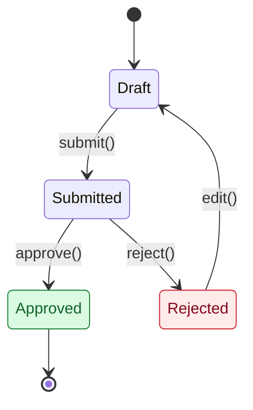

# PR & Commit Guide (Azure DevOps)

A change should answer four questions for someone reading it a year later, with no Teams history and no memory of the meeting:

1. 🟦 **Why** did this need to change?
2. 🟪 **How** did we decide, and what did we reject?
3. 🎨 **What** does the system do now, visually?
4. 🟨 **How** do I prove it still works?

---

## 1. Three layers

| Layer | Where | Length | Purpose |
|---|---|---|---|
| **Commit message** | `git log`, `git blame` | 5 to 15 lines | Short why + how + test, next to the code line |
| **PR description** | Azure Repos PR page | under 4,000 characters (hard limit) | Review summary, color coded, scannable in one screen |
| **Change record** | `docs/changes/YYYY-MM-DD-<id>-<slug>.md` | as long as needed | Full thinking, Mermaid diagrams, test plan. Lives in the repo forever |

Why the split: Azure DevOps caps PR descriptions at 4,000 characters, and Mermaid is reliably rendered in Markdown **files** (repo preview and the PR **Files** tab), not in PR descriptions. The change record also survives a migration away from Azure DevOps, because it is just a file in git.

Small changes (chore, docs, dependency bumps) can skip the change record: write `n/a: reason` in the PR.

---

## 2. Setup

```
<repo root>
├── .azuredevops/
│   ├── pull_request_template.md          ← default, applied to every new PR
│   └── pull_request_template/
│       └── quick.md                      ← optional, "Add a template" dropdown
├── docs/
│   ├── PR_GUIDE.md                       ← this file
│   └── changes/
│       ├── _TEMPLATE.md                  ← copy this per change
│       └── EXAMPLE-...md                 ← filled example
└── .gitmessage                           ← commit template
```

- PR templates must be committed to the **default branch** (usually `main`) before Azure DevOps uses them.
- To open a PR with the quick template directly, add `?template=quick.md` to the create PR URL.
- Branch-specific templates are possible too, e.g. `.azuredevops/pull_request_template/branches/release.md` for PRs into `release/*`.
- Commit template:

```bash
git config commit.template .gitmessage            # this repo
git config --global commit.template ~/.gitmessage # every repo
```

---

## 3. Color code

Every marker has its own **color and shape**, so it still reads correctly in grayscale and for red/green colorblind readers. The shape carries the bullet journal meaning; the color groups them so the eye can scan.

### 3a. Line markers (bullet journal signifiers)

| Marker | Color family | Meaning | Bullet journal | Commit (ASCII) |
|---|---|---|---|---|
| 🔵 | Blue: context | Event: incident, log line, deploy | ○ | `o` |
| 📝 | Neutral: context | Note: a fact | – | `-` |
| ✅ | Green: progress | Done, confirmed, passing | × | `x` |
| ❌ | Red: rejected | Dropped option or rejected hypothesis. Always say why | ~ (struck) | `~` |
| ➡️ | Blue: progress | Moved to a follow-up work item | > | `>` |
| ⏳ | Orange: attention | Waiting, scheduled, test not run yet | < | `<` |
| ⬜ | Neutral: progress | Open, still to do in this PR | • | `.` |
| 💡 | Yellow: attention | Insight, the thing that made it click | ! | `!` |
| ❓ | Red: attention | Question for the reviewer | ? | `?` |
| ⚠️ | Yellow: attention | Risk, something that could go wrong | | `!!` |
| ⭐ | Yellow: attention | Priority, prefix any line | * | `*` |

The most valuable marker is ❌. It records what you tried and threw away, which is exactly what gets lost in most PRs.

### 3b. Section bands

| Band | Section | Question it answers |
|---|---|---|
| 📌 | TL;DR | What is this, in one sentence? |
| 🟦 | Why | What happened, and what is the root cause? |
| 🟪 | Thinking | How did we decide, what did we reject? |
| 🟩 | Changes | What did we do? |
| 🎨 | Diagram | What does it look like now? (change record only) |
| 🟨 | Test | How do I prove it works? |
| 🟥 | Rollback | How do I undo it safely? |

### 3c. Status values

| Use | Values |
|---|---|
| Risk | 🟢 Low · 🟡 Medium · 🔴 High (always write the word, plus a reason) |
| Test result | ✅ pass · ❌ fail · ⏳ not run yet |
| Before / After | 🔴 Before · 🟢 After |

Commit messages use the ASCII column. Emoji survive in Azure Repos, but terminals, `git blame` in some IDEs, and CLI tools render them inconsistently.

---

## 4. Choosing a thinking method

| Method | Use when | What to write |
|---|---|---|
| **Hypothesis → Experiment** | Bug with several plausible causes | H1..Hn table, experiment for each, ✅ / ❌ |
| **5 Whys** | One symptom with a causal chain | Why 1 → Why 5, ending at a cause you can fix |
| **First Principles** | New design, or "we always did it this way" | The constraints that are actually true, then the design derived from them |
| **Trade-off Matrix** | Two or more workable options | Options table with pros, cons, ✅ / ❌ verdict |
| **Bisect** | Regression, "it used to work" | Good commit, bad commit, culprit and why |
| **Spike** | Unknown territory | What you tried, learned, and threw away |

Methods combine well: Hypothesis to find the cause, then Trade-off Matrix to pick the fix.

---

## 5. Choosing a UML diagram

Pick **one** diagram that carries the most meaning. Use Before / After when behaviour changes.

| Change type | Diagram | Mermaid keyword |
|---|---|---|
| Request flow, service calls, race conditions | Sequence | `sequenceDiagram` |
| Status or lifecycle bugs | State | `stateDiagram-v2` |
| Refactor of types, modules, interfaces | Class | `classDiagram` |
| Branching rules, validation logic | Activity | `graph TD` (not `flowchart`: the Azure DevOps wiki does not support it) |
| Schema change | Entity-Relationship | `erDiagram` |

### 5a. Diagram color palette

Same meaning as the line markers. Light fills with dark text, so diagrams stay readable in both light and dark theme.

| Meaning | Fill | Stroke | Text | Sequence `rect` |
|---|---|---|---|---|
| 🔴 Bug / removed | `#ffebe9` | `#cf222e` | `#82071e` | `rgb(255, 235, 233)` |
| 🟢 New / fixed | `#dafbe1` | `#1a7f37` | `#116329` | `rgb(218, 251, 225)` |
| 🟡 Changed | `#fff8c5` | `#9a6700` | `#7d4e00` | `rgb(255, 248, 197)` |
| 🔵 Unchanged context | `#ddf4ff` | `#0969da` | `#0a3069` | `rgb(221, 244, 255)` |

Use these palette definitions with syntax supported by the chosen diagram type and target renderer; validate graph, class and state styling separately:

```
classDef bug fill:#ffebe9,stroke:#cf222e,color:#82071e
classDef added fill:#dafbe1,stroke:#1a7f37,color:#116329
classDef changed fill:#fff8c5,stroke:#9a6700,color:#7d4e00
classDef context fill:#ddf4ff,stroke:#0969da,color:#0a3069
```

In sequence diagrams, wrap the interesting steps in a `rect` block and label them with a `Note`:

```
rect rgb(255, 235, 233)
Note over A,D: BUG: what goes wrong here
A->>D: query
end
```

State diagram starter:



---

## 6. Writing tests the reader can trust

- **Regression first.** The test that reproduces the original bug must fail on `main` and pass on your branch. Say so.
- **Given / When / Then** in the matrix, so scenarios read without opening the test file.
- **Give the exact command.** `pnpm test -- payment/idempotency` beats "run the tests".
- **Evidence over claims.** A log line, screenshot, App Insights query, or before/after number.
- If the pipeline publishes test results, link the build run in the Evidence line.

---

## 7. Azure DevOps gotchas

| Gotcha | What to do |
|---|---|
| 4,000 character limit on PR descriptions | Keep detail in the change record. The empty template is about 950 characters and the filled example below about 1,900, so there is room |
| Work item link inside a table | Put a space on both sides: `| #412 |` |
| `Fixes #412` in a commit | Resolves the work item only when the commit reaches the default branch by push, or by PR completion **without squash** with "Complete associated work items" ticked |
| Squash merge | Azure DevOps builds the squash commit message at completion. Replace it with the `.gitmessage` format before you click Complete |
| A commit line starting with `#412` | Git deletes it as a comment. Write `Refs: #412` |
| Templates not showing | They must be on the default branch, and the file name is not case sensitive |
| Mermaid `flowchart` keyword | Use `graph TD` so the same diagram also works if pasted into the wiki |

---

## 8. Worked example

Full illustrative change record: [`EXAMPLE-2026-10-15-412-payment-idempotency.md`](EXAMPLE-2026-10-15-412-payment-idempotency.md)

### PR description

```markdown
## 📌 TL;DR

> Payment capture is now idempotent, so client retries no longer charge twice.

| Type | Work item | Risk | Change record |
|---|---|---|---|
| fix | #412 | 🟡 Medium: money path, behind a flag | `docs/changes/2026-10-15-412-payment-idempotency.md` |

## 🟦 Why

🔵 2026-10-14 customer charged twice for order A-1043
🔵 Two capture calls 1.8s apart on different pods
📝 Mobile retries after 3s; capture p99 is 4.1s

**Problem:** When capture is slower than the client timeout, the app retries and the API captures again, because capture is not idempotent.
**Impact:** about 0.4% of peak captures since 2026-09-30.

## 🟪 Thinking

**Method:** Hypothesis → Experiment, then Trade-off

❌ Gateway duplicate webhook: dashboard shows one per charge
❌ Raise client timeout: hides the bug
❌ Redis lock: extra infra, TTL edge cases
💡 Retry is correct client behaviour; the server must be idempotent

**Decision:** Idempotency-Key + unique DB row, because it is atomic across pods and survives restarts. Trade-off: new table and a client change.

## 🟩 Changes

✅ `IdempotencyInterceptor` + `idempotency_records` migration
✅ Flag `PAYMENT_IDEMPOTENCY_ENABLED` (default off)
➡️ Mobile sends the key: #88
❓ Key retention: 24h or 7d?

## 🟨 Test

**Repro:** two parallel captures with the same key, gateway latency 3.5s. 🔴 Before: 2 charges. 🟢 After: 1.

| Level | Given / When / Then | How | Result |
|---|---|---|---|
| Unit | Stored K + same body, replay without gateway call | `pnpm test -- idempotency` | ✅ |
| Regression | Two concurrent requests with K, one gateway call | `pnpm test:int -- capture-concurrency` | ✅ |
| Edge | No header uses fallback; flag off keeps old path | `pnpm test -- capture.flag` | ✅ |

## 🟥 Rollback

**Migration:** reversible · **Flag:** `PAYMENT_IDEMPOTENCY_ENABLED` · **Undo:** flag off · **Watch after deploy:** duplicate-capture alert, 48h
```

### Commit message

```
fix(payment): prevent double capture on client retry

Why:
Mobile retries capture after a 3s timeout; capture p99 is 4.1s, and
nothing made the request idempotent, so retries charged twice.

How:
Method: hypothesis -> trade-off. Idempotency-Key header backed by a
unique (scope, key) row; replays return the stored response.

Log:
x interceptor + idempotency_records migration
x flag PAYMENT_IDEMPOTENCY_ENABLED (default off)
~ Redis lock: extra infra, TTL edge cases
~ client timeout bump: hides the bug
! retry is correct client behaviour; server must be idempotent
> mobile sends key: #88

Test:
pnpm test:int -- capture-concurrency (2 parallel requests, 1 capture)

Refs: #412
Record: docs/changes/2026-10-15-412-payment-idempotency.md
```

## Package corrections and evidence boundaries

- Add a template appends content; remove the default content manually or use the documented query-string override.
- Mermaid support refers to file previews, not raw diffs. Generic rendering does not confirm Azure rendering or theme accessibility.
- Preserve the full format; use reasoned n/a for inapplicable sections and actual methods/alternatives only. Never invent a rejected option.
- Test results in worked examples are fictional. Templates default to Not run. Regression-before/after requirements apply to bugs; other changes need proportionate verification.
- Risk and status need written words. Emoji and colors alone do not establish accessibility across clients.
- Character figures above are illustrative, not validation of a filled description. Count each final description including links and Markdown.
- Commit resolution requires the repository setting and supported workflow. Rewriting squash messages is not a guaranteed workaround.
- Microsoft documents the description limit directly: https://learn.microsoft.com/en-us/rest/api/azure/devops/git/pull-requests?view=azure-devops-rest-7.1.
- The payment example has explicit unresolved technical caveats; it is not a validated production implementation.
