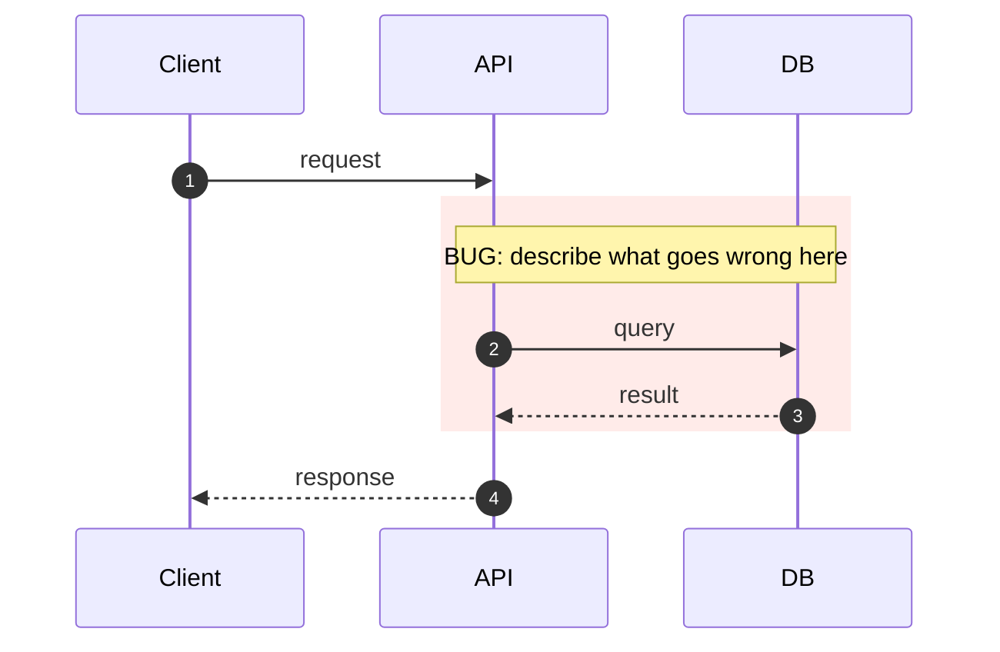
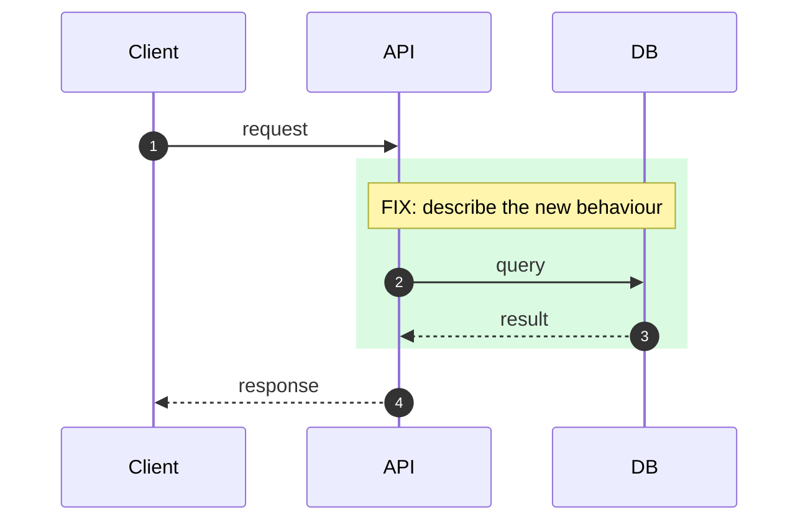

# <Title: what changed, in plain words>

| Field | Value |
|---|---|
| Work item | #  |
| Pull request | link |
| Author | |
| Date | YYYY-MM-DD |
| Type | fix / feat / refactor / perf |
| Risk | 🟢 Low / 🟡 Medium / 🔴 High: because … |

> **Copy this file** to `docs/changes/YYYY-MM-DD-<workitem>-<slug>.md`, fill it in, and commit it with the PR.
> It renders (including Mermaid) in the PR **Files** tab file preview and stays in the repo next to the code it explains.

**Color legend**

| Mark | Meaning | Use for |
|---|---|---|
| 🔵 | Event | Something that happened: incident, log line, deploy |
| 📝 | Note | A fact |
| ✅ | Done / confirmed | Finished work, confirmed hypothesis, passing test |
| ❌ | Dropped / rejected | Option or hypothesis ruled out. Always say why |
| ➡️ | Moved | Pushed to a follow-up work item (link it) |
| ⏳ | Waiting | Scheduled, blocked, or test not run yet |
| ⬜ | Open | Still to do in this PR |
| 💡 | Insight | The thing that made it click |
| ❓ | Question | Needs reviewer input |
| ⚠️ | Risk | Something that could go wrong |
| ⭐ | Priority | Prefix any line to mark it important |

---

## 🟦 1. Why (Context Log)

Log what happened in order. Facts and events only, no solution yet.

- 🔵
- 📝
- 📝

**Problem statement:** When `<trigger>`, `<who>` sees `<symptom>`, because `<root cause>`.
**Impact:** who is affected, how often, since when.

---

## 🟪 2. Thinking (How we decided)

**Method:** Hypothesis → Experiment / 5 Whys / First Principles / Trade-off Matrix / Bisect / Spike

### 2a. Investigation trail

| # | Hypothesis | Experiment / Evidence | Result |
|---|---|---|---|
| H1 | | | ✅ confirmed / ❌ rejected |
| H2 | | | |

- 💡 **Insight:**

### 2b. Options considered

| Option | Pros | Cons | Verdict |
|---|---|---|---|
| A. | | | ✅ chosen |
| B. | | | ❌ dropped: reason |

**Decision:** We chose **A** because … We accept the trade-off that …

**Assumptions** (if any become false, revisit this change):
- 📝

---

## 🟩 3. What changed

- ✅
- ✅
- ➡️
- ❓

**Files that matter:**
- `path/to/file.ts`: what and why

---

## 🎨 4. Diagram

Pick the ONE diagram that explains the change best. Use the color palette in `docs/PR_GUIDE.md`:
🔴 red = bug or removed · 🟢 green = new or fixed · 🟡 yellow = changed · 🔵 blue = unchanged context.

### Before



### After



---

## 🟨 5. How to test

### 5a. Reproduce the original problem (fix only)

1.
2.

- 🔴 **Before:**
- 🟢 **After:**

### 5b. Test matrix

| Level | Given / When / Then | How | Result |
|---|---|---|---|
| Unit | Given …, when …, then … | `pnpm test -- <path>` | ⏳ |
| Integration | | | ⏳ |
| E2E / Manual | | | ⏳ |
| Regression | The exact case that broke before | | ⏳ |
| Edge | empty / null / concurrent / timezone / large input | | ⏳ |

### 5c. Run it yourself

```bash
pnpm install
pnpm test -- <pattern>
```

### 5d. Evidence

Screenshot, log excerpt, query result, before/after numbers.

---

## 🟥 6. Release & Rollback

| Item | Detail |
|---|---|
| DB migration | none / reversible / ⚠️ irreversible: why |
| Feature flag | |
| Config / variable group / Key Vault | |
| Rollback plan | revert PR / toggle flag / run down migration |
| Watch after deploy | metric, App Insights query, or alert + for how long |

---

## ⬜ 7. Note to future you

- 💡 If I hit this again, I would:
- ➡️ Follow-ups:

---

### Author checklist

- [ ] Why explains the goal/constraint, or the evidenced root cause for a bug
- [ ] Actual ❌ rejected hypotheses/options include reasons; otherwise state none evaluated
- [ ] Diagram matches the reviewed code revision
- [ ] For a bug, record before/after regression evidence or an explicit verification gap
- [ ] Rollback plan is written
